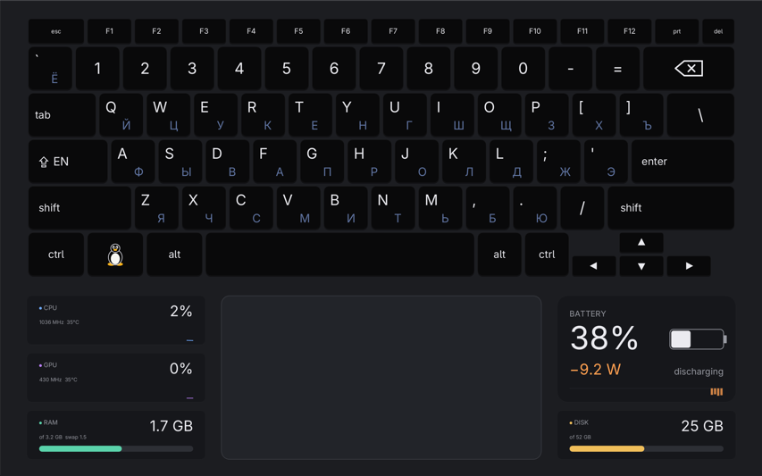
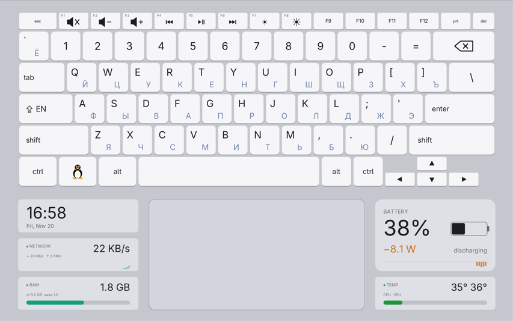
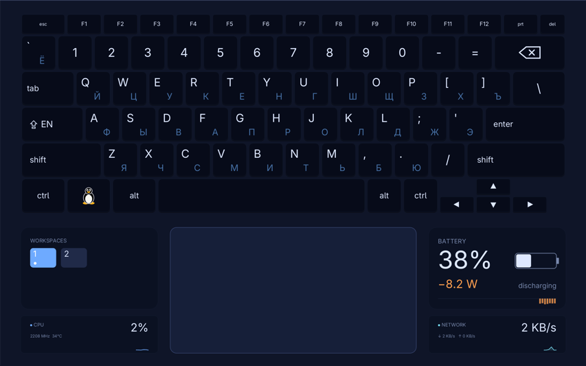
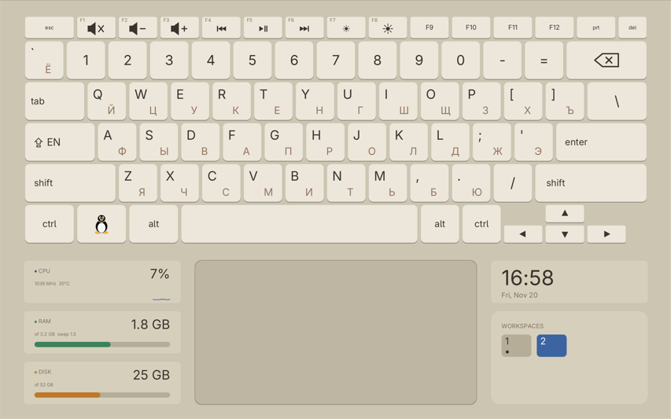
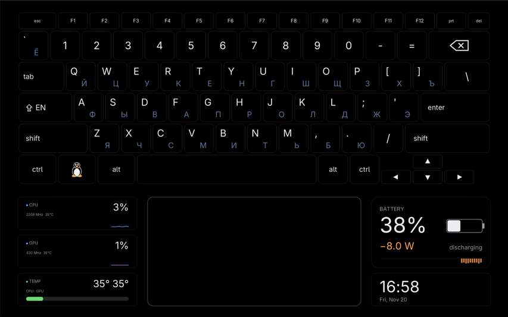
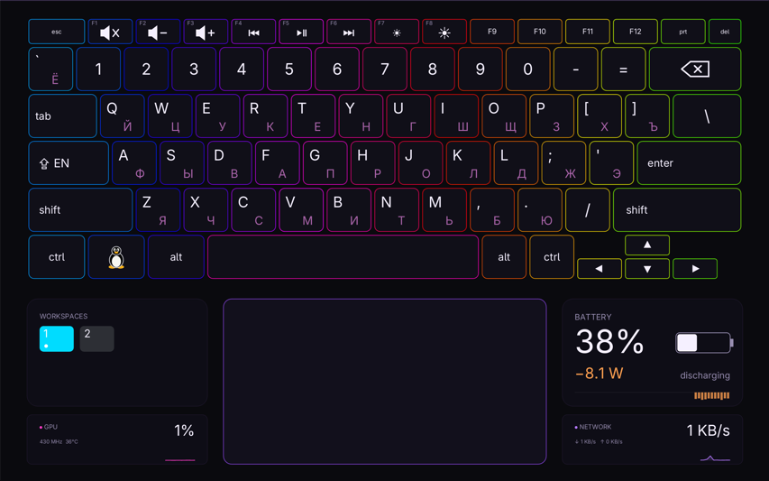
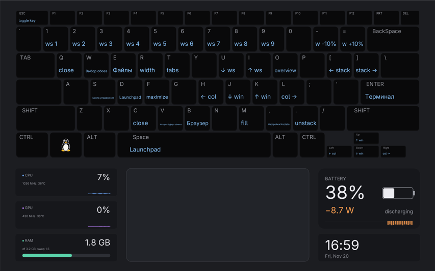
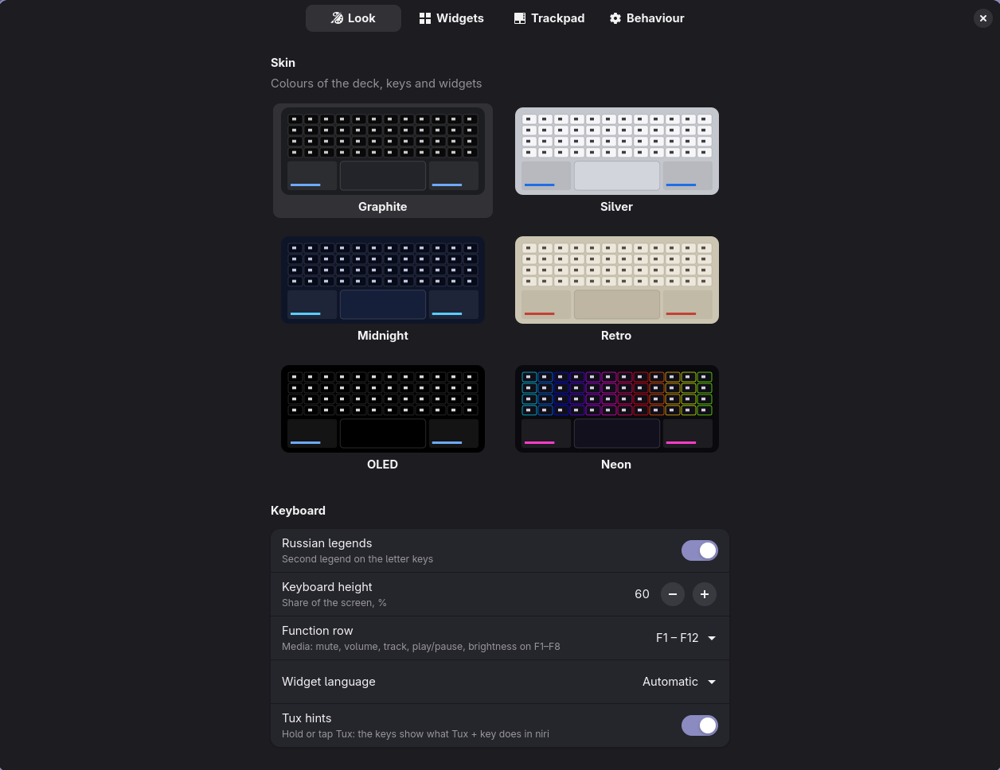

# laptopkbd

**Turn a Linux tablet into the bottom half of a laptop.** Plug in a monitor and the
tablet's touchscreen becomes a full laptop keyboard with a trackpad between two
palm rests, and the palm rests show live widgets: CPU, GPU, memory, battery and charge
power, network, clock, your niri workspaces. Unplug the monitor and the tablet is a
tablet again.



It is a single small Rust program for the [niri](https://github.com/YaLTeR/niri) Wayland
compositor. It talks to niri over its IPC socket, draws its own UI with a CPU
rasteriser into shared memory (no GTK, no GPU context, no browser engine), and sends
keys and pointer motion through `/dev/uinput`. The compositor sees a real keyboard and mouse,
so every niri bind works, `Mod+Return` included.

Built for (and on) a Samsung Galaxy Tab S7 FE running mainline Linux and Arch Linux ARM,
but nothing in it is specific to that tablet: the panel, touchscreen and rotation are settings.

## Screenshots

| | |
|---|---|
|  |  |
| **Silver**: media keys on the F-row, clock, network, temperatures | **Midnight**: niri workspaces map (tap to switch) |
|  |  |
| **Retro** | **OLED**: outlines only, true black |
|  |  |
| **Neon**: rainbow key edges | **Tux hints**: hold Tux and every key shows its niri bind |

The settings window (GTK 4 / libadwaita):



## Features

**Keyboard**
- Laptop layout: Esc and F-row, number row, arrows in an inverted T, Tux key in place of Win.
- Second legend per key (Russian by default), highlighted by the active xkb layout, which comes
  live from niri's event stream; the Caps key shows and switches it.
- Latching modifiers: tap Shift/Ctrl/Alt/Tux for the next key, double-tap to lock, or hold
  one with a finger and press keys with another (real multi-touch chords).
- F-row as F1–F12 or as media keys (mute, volume, previous/play/next, brightness).
- **Tux hints**: while Tux is held or latched, each key shows what `Mod+key` does,
  read from your niri config (`hotkey-overlay-title`, else a short name of the action).
- Hold Esc for 2 s to leave laptop mode until the monitor is plugged in again.

**Trackpad**
- One finger moves the pointer; tap = click; tap, then touch and move = drag.
- Two fingers: tap = right click, move = scroll (natural or classic).
- Three fingers: tap = middle click, swipe left/right = focus column, up/down = workspace.
  Four fingers up = niri overview.
- Pointer speed, width, tap-to-click, gestures: all settings.

**Palm-rest widgets** (three slots per side, pick any): CPU load with history, frequency and
temperature · GPU busy time (from DRM fdinfo) with history · RAM and swap · disk ·
battery, with **charge/discharge power in watts** and a history of it · network
throughput · clock · temperatures · **niri workspaces** with window counts (tap a tile to
switch).

**Laptop mode**
- Starts by itself when niri reports a second output, and ends when it goes away.
- Moves your workspaces from the tablet panel to the monitor and focuses the monitor.
- Moves the panel far away in niri's layout, so the pointer can't wander onto the keyboard.
- Grabs the touchscreen (`EVIOCGRAB`), so niri never turns touches into pointer jumps.
- Hooks: shell commands on enter/leave, e.g. to pause an auto-rotation script or a
  touch-gesture daemon.
- Preview without a monitor from the settings window, or with `pkill -USR1 laptopkbd`.

## Light on resources

On a 3 GB tablet (Snapdragon 750G), measured on the device:

| | laptopkbd (Rust) | first prototype (Python + GTK 4) |
|---|---|---|
| Binary | 1.5 MB, one file | Python, PyGObject, GTK 4, gtk4-layer-shell |
| Memory, laptop mode | 53 MB PSS, of which 32 MB are the two frame buffers shared with the compositor; 0 in swap | 51 MB RSS + 38 MB pushed to swap |
| CPU, laptop mode, nothing touched | 1.7 s per minute (≈2.8 % of one core), almost all of it the widget refresh every 2 s | redrew the whole keyboard on every touch event (120 per second) |
| Full keyboard redraw (Tux hints on/off) | ≈59 ms | |
| Threads | 4 | |
| Settings window | separate 0.5 MB binary, runs only while open | |
| Without a monitor (idle) | 26 MB PSS, 10 ms of CPU per minute | |

What makes it cheap:
- **No toolkit at runtime.** The keyboard is a bare Wayland client (smithay-client-toolkit)
  that draws with tiny-skia and fontdue into two shm buffers.
- **Damage-only redraws.** A key press redraws that key and sends only its rectangle to the
  compositor; a touch that moves the pointer redraws nothing at all.
- **No polling where an event exists.** The keyboard layout, workspaces and windows, and niri
  config reloads all come from niri's event stream. Outputs are asked for every 2 s, because
  niri has no output events: one IPC request, well under a millisecond.
- **Idle when unused.** Without a monitor there is no surface, no touchscreen grab, no
  uinput device and no timer, only two sleeping threads.
- Raw multi-touch is read straight from evdev, and every niri request goes over the socket
  directly (no `niri msg` processes).

## Requirements

- **niri** 26.04 or newer (layer shell, `wp_viewporter`, IPC), started as a session.
- A touchscreen exposed as an evdev multi-touch device.
- Write access to `/dev/uinput` and read access to the touchscreen: be in the `input` group
  and install [`contrib/90-uinput.rules`](contrib/90-uinput.rules).
- For the settings window: GTK 4.12+ and libadwaita 1.5+.

## Build and install

```sh
cargo build --release --workspace
install -Dm755 target/release/laptopkbd          ~/.local/bin/laptopkbd
install -Dm755 target/release/laptopkbd-settings ~/.local/bin/laptopkbd-settings
install -Dm644 contrib/laptopkbd-settings.desktop ~/.local/share/applications/laptopkbd-settings.desktop
sudo install -Dm644 contrib/90-uinput.rules /etc/udev/rules.d/90-uinput.rules
```

Cross-compiling for an ARM tablet works with a sysroot copied from the device
(glibc, plus GTK and libadwaita for the settings window). The keyboard itself has no C
dependencies beyond libc.

Start it with niri, in `~/.config/niri/config.kdl`:

```kdl
spawn-at-startup "laptopkbd"
```

## Configuration

`~/.config/laptopkbd/config.toml`, written by **laptopkbd-settings** (every change applies at
once). The file can also be edited by hand. Then run `pkill -HUP laptopkbd` to apply it. All keys,
with their defaults, are in [`contrib/config.example.toml`](contrib/config.example.toml).
The `[device]` section is the part to adapt for another tablet:

```toml
[device]
output = "DSI-1"                  # niri name of the built-in panel
touchscreen = "FocalTech FT8203"  # substring of its evdev name
transform = "270"                 # panel transform in laptop mode; touch mapping follows it
on_enter = "pkill -x squeekboard" # shell hooks
on_leave = ""
```

Signals: `SIGHUP` reloads the config, `SIGUSR1` toggles the preview, and `SIGUSR2` toggles the
Tux hints (for screenshots).

## Credits

The idea of a keyboard overlay that never takes focus, driven through uinput, comes from
[hingeboard](https://github.com/brysonwf/hingeboard), a laptop mode for the dual-screen
Surface Duo. laptopkbd is a separate implementation: one screen instead of two, in Rust
instead of Python and GTK, and built for niri.

Written by Claude (Anthropic's AI) working on the tablet over SSH, with
[Marker284](https://github.com/Marker284) directing and testing.

## License

GPL-2.0-or-later, see [LICENSE](LICENSE).
